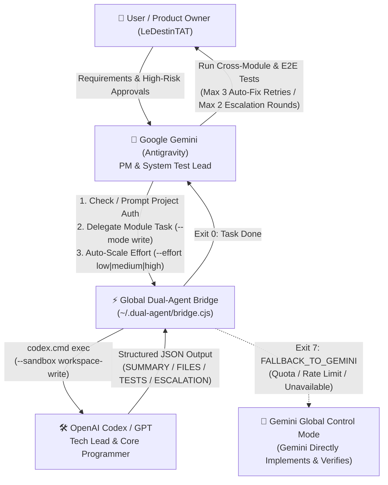

# Antigravity-Codex-Workspace (`DualAgent Global Codex Bridge`)

[](LICENSE)
[](#prerequisites--环境要求)
[](#prerequisites--环境要求)
[](#architecture--role-division--双-agent-协作架构)
[](#co-developers--maintainers--共同开发者与维护团队)

> **An open-source, user-level Windows Global Multi-Project Collaboration Bridge uniting Google Gemini (Antigravity) and OpenAI Codex / GPT into a structured, autonomous software engineering team.**
>
> **一个开源的 Windows 全局多项目双 Agent 协同开发桥接系统 —— 将 Google Gemini (Antigravity) 与 OpenAI Codex / GPT 整合为“项目经理 + 首席架构师/核心程序员”的自动化软件研发团队。**

📖 **配套文档 (Documentation Links)**：
- [中文迁移与恢复指南 (RESTORE.zh-CN.md)](RESTORE.zh-CN.md)
- [依赖与环境配置清单 (DEPENDENCIES.zh-CN.md)](DEPENDENCIES.zh-CN.md) · [环境变量示例 (config/environment.example.ps1)](config/environment.example.ps1)
- [开源许可证 (MIT License)](LICENSE)

---

## Table of Contents / 目录

1. [Overview / 项目简介](#overview--项目简介)
2. [Architecture & Role Division / 双 Agent 协作架构](#architecture--role-division--双-agent-协作架构)
3. [Key Features / 核心特性](#key-features--核心特性)
4. [Prerequisites / 环境要求](#prerequisites--环境要求)
5. [Quick Start & Installation / 快速开始与安装](#quick-start--installation--快速开始与安装)
6. [CLI Reference / 命令行参考手册](#cli-reference--命令行参考手册)
7. [Changelog / 版本发布说明](#changelog--版本发布说明)
8. [Testing & Verification / 自动化测试](#testing--verification--自动化测试)
9. [Co-Developers & Maintainers / 共同开发者与维护团队](#co-developers--maintainers--共同开发者与维护团队)
10. [License / 开源协议](#license--开源协议)

---

## Overview / 项目简介

**Antigravity-Codex-Workspace** provides a zero-dependency, background single-instance daemon (`~/.dual-agent/`) and a global Antigravity skill (`codex-delegate`) that enable **Google Gemini (Antigravity)** and **OpenAI Codex / GPT (`codex.cmd`)** to collaborate across any number of local projects without per-project setup boilerplate or nested terminal sandbox conflicts.

不同于传统的“主模型写代码 + 副模型只读 Review”或两个对等模型无休止争辩的模式，本项目实现了 **T008+ 非对称软件工程团队架构**：
- **Google Gemini (Antigravity)** 担任 **项目经理 (PM) + 系统测试负责人 (System Test Lead)**，负责需求拆解、上下文协调、跨模块/E2E 综合验证与产品级验收。
- **OpenAI Codex / GPT** 担任 **技术负责人 (Tech Lead) + 核心程序员 (Core Implementer)**，掌控所有生产代码编写、技术路线选型、局部单测与**最终技术裁决权 (`Codex-Discretion Escalation`)**。
- 当遇到 **GPT/Codex 额度受限或网络不可用** 时，系统会自动触发 **`FALLBACK_TO_GEMINI`（退出码 `7`）**，无缝切换为 **Gemini 全局支配模式**，确保研发流程永不中断。

---

## Architecture & Role Division / 双 Agent 协作架构



### Role Matrix / 角色职责矩阵

| Dimension / 维度 | 🧠 Google Gemini (Antigravity) | 🛠️ OpenAI Codex / GPT |
| :--- | :--- | :--- |
| **Team Role / 团队定位** | **Project Manager & System Test Lead**<br>项目经理 + 系统测试负责人 | **Technical Lead & Core Programmer**<br>技术负责人 + 核心程序员 |
| **Primary Responsibilities / 核心职责** | 需求解析、模块拆分、任务委派、跨模块/E2E 集成测试、产品级验收 | 架构设计、算法实现、全部业务/测试代码编写、重构调试、局部单测 |
| **Direct Code Editing / 直接改写业务代码** | 默认禁止（仅当触发 `FALLBACK_TO_GEMINI` 退出码 `7` 时接管全局编码） | **100% 掌控**（在授权项目工作区内通过 `workspace-write` 直接落盘） |
| **Technical Authority / 技术裁决权** | 可基于需求约束或客观测试失败提出质疑并提交证据 | **拥有最终技术裁决权 (`Codex-Discretion Escalation`)** |
| **Loop Guardrails / 闭环熔断保护** | 自动 Bug 修复委派最多 **3 次** (`retryCount <= 3`) | 同一技术分歧协商最多 **2 轮** (`escalationRound <= 2`) |

---

## Key Features / 核心特性

### 1. Ask-First Per-Project Authorization / 新项目“先询问、后自动注册”
- Ships with `trustedRoots: []` by default so unknown projects are **never** silently registered.
- When entering a new project (`check-project` returns exit code `2`), Gemini prompts the user once and, upon approval, automatically executes `authorize-write --project <dir>` (enabling `workspace-write`) or `register --project <dir>` (read-only). No manual skill copying required.

### 2. Dynamic Reasoning Effort & Model Scaling / 动态推理强度与模型调节
- Supports `--effort low|medium|high` and `--model <model-name>` on every task (injected into `codex.cmd` via `-c model_reasoning_effort="<effort>"`).
- **Smart Auto-Scaling** (when `--effort` is omitted):
  - `low`: `VERIFY`, `REVIEW`, formatting, syntax/type checks, or single-line configuration tweaks.
  - `medium`: Standard module `IMPLEMENT` and initial `FIX_REQUEST` (`retryCount <= 1`).
  - `high`: Complex multi-module architecture, `TECHNICAL_ESCALATION` / `TECHNICAL_DECISION`, or repeated bug fixes (`retryCount >= 2`).

### 3. Automatic Gemini Global Control Fallback / GPT 受限时自动切换 Gemini 全局支配
- Real-time detection of OpenAI/ChatGPT usage limits, rate limits (`429`), quota exhaustion, or service unavailability across `stdout`, `stderr`, and output files.
- Automatically marks `protocolStatus: "FALLBACK_TO_GEMINI"` and exits `client.cjs` with **exit code `7`**.
- Upon receiving exit code `7`, **Gemini immediately assumes full global control** (architecting, writing/editing code, and testing directly) without blocking the user. Dual-agent mode can be restored anytime via `clear-fallback` or the next successful Codex run.

### 4. Per-Project Session Continuity / 同项目会话复用与跨项目隔离
- Persists `lastSessionId` per project in `~/.dual-agent/projects.json`.
- Passing `--reuse-session` (or `--session-id <taskId>`) automatically prepends a compact 1,200-character incremental context summary from the previous completed task in the **same** project while strictly rejecting cross-project session IDs.

### 5. Hardened Windows Sandbox & Security Guardrails / 安全沙箱与路径边界保护
- Enforces canonical path resolution (`fs.realpathSync.native`) and `path.relative` boundary checks to prevent `..` traversal, prefix collisions, and symlink/junction escapes.
- Automatically detects the deepest `.git` root for nested repositories.
- Blocks filesystem roots (`C:\`), Windows system directories (`C:\Windows`, `Program Files`), and the user profile root (`%USERPROFILE%`) from being registered or authorized.

### 6. Zero-Admin Auto-Start & Standalone Installer / 免管理员开机自启与一键安装包
- Compiles a windowless native C# launcher (`dual-agent-launcher.exe`) and self-extracting installer (`DualAgentSetup.exe`) using the built-in Windows .NET Framework compiler (`csc.exe`).
- Uses WMI `Win32_Process.Create` process detachment so the background Bridge daemon survives parent terminal Job Object termination.

---

## Prerequisites / 环境要求

- **OS**: Windows 10 / Windows 11 (x64)
- **Node.js**: `v22+` recommended (`v18+` compatible; `node.exe` in `PATH`)
- **Codex CLI**: Installed and authenticated (`codex.cmd` in `PATH` or `%APPDATA%\npm\codex.cmd`)
- **Git**: Installed (`git.exe` in `PATH`)

Run the built-in environment checker anytime:
```powershell
npm run check:environment
```

---

## Quick Start & Installation / 快速开始与安装

### Option A: Using Standalone `DualAgentSetup.exe` / 使用独立安装包

```powershell
# 1. Install Global Bridge (~/.dual-agent), global codex-delegate Skill, and Windows logon auto-start:
.\DualAgentSetup.exe install

# 2. Verify daemon health & configuration:
.\DualAgentSetup.exe doctor

# 3. (Optional) Initialize collaboration files + workspace-write permission for a project:
.\DualAgentSetup.exe init-project --project "D:\Projects\MyApp" --allow-write
```

### Option B: Install from Source Repository / 从源码仓库安装

```powershell
# 1. Clone the repository:
git clone https://github.com/LeDestinTAT/Antigravity-Codex-Workspace.git
cd Antigravity-Codex-Workspace

# 2. Install Global Bridge & Skill:
.\install.ps1 install

# 3. (Optional) Rebuild standalone DualAgentSetup.exe & portable zip bundle in .\dist\ :
powershell -ExecutionPolicy Bypass -File .\build-exe.ps1
```

---

## CLI Reference / 命令行参考手册

All commands invoke `~/.dual-agent/client.cjs`:

```powershell
$client = Join-Path $HOME ".dual-agent\client.cjs"
```

### 1. Project Registration & Write Authorization / 项目注册与读写授权

```powershell
# Check project registration & write status (Exit 0 = registered, Exit 2 = unregistered):
node $client check-project --project "D:\Projects\MyApp"

# Authorize a project for Codex workspace-write mode (auto-registers if new):
node $client authorize-write --project "D:\Projects\MyApp"

# Downgrade a project back to read-only mode:
node $client revoke-write --project "D:\Projects\MyApp"

# Register a project in read-only mode only:
node $client register --project "D:\Projects\MyApp"
```

### 2. Delegating Tasks to Codex / 委派开发与修复任务

```powershell
# Standard module implementation (workspace-write, auto-scaled medium effort):
node $client run --project "D:\Projects\MyApp" `
  --mode write --task-type IMPLEMENT --effort medium --reuse-session `
  --prompt "Goal: Implement JWT auth middleware. Constraints: Express 5. Acceptance: Unit tests pass."

# Low-cost verification / syntax check (saves tokens with low reasoning effort):
node $client run --project "D:\Projects\MyApp" `
  --mode write --task-type VERIFY --effort low --reuse-session `
  --prompt "Run unit tests for auth middleware and report concise results."

# Complex architectural decision or bug fix retry (high reasoning effort):
node $client run --project "D:\Projects\MyApp" `
  --mode write --task-type FIX_REQUEST --effort high --retry-count 2 --reuse-session `
  --prompt "Fix integration test failure in token refresh flow."

# Clear FALLBACK_TO_GEMINI state after Codex quota resets:
node $client clear-fallback --project "D:\Projects\MyApp"
```

### Client Exit Codes / 退出码说明

| Exit Code | Meaning / 含义 | Recommended Action / 处理方式 |
| :---: | :--- | :--- |
| `0` | Task completed (`COMPLETED`) | Parse structured `SUMMARY`, `FILES_CHANGED`, `TESTS_RUN`, `ESCALATION` |
| `1` | General execution / validation error | Inspect error output or retry |
| `2` | Project is not registered (`UNREGISTERED`) | Prompt user for permission, then run `authorize-write` or `register` |
| `7` | **Codex Quota / Rate Limit / Unavailable (`FALLBACK_TO_GEMINI`)** | **Switch to Gemini Global Control Mode immediately** |

---

## Changelog / 版本发布说明

### `v1.1.0` — T008+ Dual-Agent Architecture Upgrade (2026-10-17)
- **Asymmetric Team Architecture**: Upgraded from read-only Reviewer mode to **Gemini (PM + System Test Lead) + Codex (Tech Lead + Core Implementer)** with `Codex-Discretion Escalation` (max 2 escalation rounds, max 3 bug-fix retries).
- **Dynamic Reasoning Effort (`--effort low|medium|high`) & Model Selection (`--model`)**: Added automatic task-complexity effort scaling and updated default reasoning effort to `medium` to prevent token waste on simple tasks.
- **Gemini Global Control Fallback (`FALLBACK_TO_GEMINI`, Exit Code `7`)**: Added automatic detection of OpenAI/Codex rate/usage limits and seamless handover to Gemini Global Control, plus `clear-fallback` recovery.
- **Per-Project Session Continuity (`--reuse-session`)**: Added `lastSessionId` persistence per project and 1,200-char incremental session context injection with strict cross-project isolation.
- **Ask-First New Project Workflow**: Configured default `trustedRoots: []` so every new project asks the user first and auto-registers upon approval.
- **WMI Detached Daemon Startup**: Hardened `deploy.cjs` daemon creation on Windows via `Win32_Process.Create` so the Bridge survives parent shell termination.

### `v1.0.0` — Initial Global Bridge Release
- User-level single-instance HTTP Bridge (`127.0.0.1:43115`) with Bearer token auth, `fs.realpathSync.native` sandbox path validation, `dual-agent-launcher.exe` logon auto-start, and `DualAgentSetup.exe` one-click installer.

---

## Testing & Verification / 自动化测试

The repository includes **35 end-to-end and unit tests** covering path traversal protection, sandbox permissions, T008+ write/test/fix/escalation workflows, session continuity, dynamic effort scaling, `FALLBACK_TO_GEMINI` exit code `7`, and `.exe` installer compilation:

```powershell
npm test
```

---

## Co-Developers & Maintainers / 共同开发者与维护团队

This open-source project is jointly designed, built, tested, and maintained by human and AI co-developers:

| Developer / 开发者 | Role / 角色定位 | Contributions / 核心贡献 |
| :--- | :--- | :--- |
| **[@LeDestinTAT](https://github.com/LeDestinTAT)** | **Creator, Product Owner & Maintainer**<br>项目发起人、产品负责人与主维护者 | 架构愿景定义、权限与安全策略决策、动态推理强度与 Fallback 机制设计、开源发布 |
| **Google Gemini (Antigravity)** | **Co-Developer · PM & System Test Lead**<br>共同开发者 · 项目经理与系统测试负责人 | 全局架构协调、任务拆解与上下文编排、跨模块/E2E 自动化测试体系、文档与发布工程 |
| **OpenAI Codex / GPT** | **Co-Developer · Tech Lead & Core Programmer**<br>共同开发者 · 技术负责人与核心程序员 | Global Bridge 核心守护进程与客户端实现、Windows 沙箱与安全边界校验、核心代码架构裁决 |

---

## License / 开源协议

This project is open-sourced under the **[MIT License](LICENSE)**.  
Copyright © 2026 **[LeDestinTAT](https://github.com/LeDestinTAT)**, **Google Gemini (Antigravity)**, and **OpenAI Codex / GPT** (Co-Developers).
